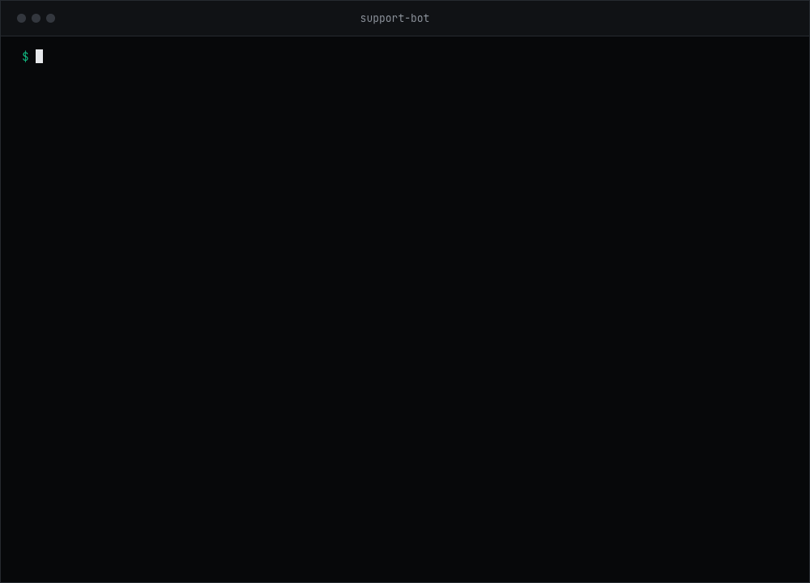

<div align="center">
  
  <h1>judgekeeper <sup><sup><sub>™</sub></sup></sup></h1>
  <p><strong>Check your LLM-as-a-judge in 5 steps.</strong><br>Find. Mark. Measure. Fix. Re-check.</p>
  <p>
    <a href="https://pypi.org/project/judgekeeper/"></a>
    <a href="https://github.com/judgekeeper/judgekeeper/actions/workflows/ci.yml"></a>
    <a href="https://github.com/judgekeeper/judgekeeper/blob/main/LICENSE"></a>
  </p>
  <p>
    <a href="https://www.judgekeeper.com">Website</a> ·
    <a href="https://www.judgekeeper.com/start.html">Guide</a> ·
    <a href="https://github.com/judgekeeper/judgekeeper/blob/main/docs/reference.md">Reference</a> ·
    <a href="https://github.com/judgekeeper/judgekeeper/blob/main/CHANGELOG.md">Changelog</a>
  </p>
</div>

An LLM-as-a-judge is an AI model that grades another model's answers. judgekeeper shows how often your LLM-as-a-judge agrees with you, and where it goes wrong. No LLM-as-a-judge? judgekeeper can also check your AI's answers directly ([see below](#no-llm-as-a-judge-check-your-ais-answers)).



## Install

In your project folder, in its virtual environment:
```
pip install judgekeeper
judgekeeper
```
Or, with no virtual environment: `uvx judgekeeper`. Python 3.11 to 3.14.

Reads promptfoo, DeepEval, Inspect AI, MLflow, or your own CSV, TSV or JSONL file with `input`, `output` and `verdict` columns, or a file with only `input` and `output` to check your AI's answers. A `verdict` can be pass/fail, true/false, yes/no, correct/incorrect, right/wrong or 1/0, in any case; `--label-map` reads other words. Inspect AI `.eval` logs and MLflow need an extra: `pip install "judgekeeper[inspect]"` or `pip install "judgekeeper[mlflow]"` (the uv forms are in the [reference](https://github.com/judgekeeper/judgekeeper/blob/main/docs/reference.md#install)).

Using a coding agent? Give it this page and tell it: "Follow this to check my LLM-as-a-judge." It runs the steps and gives you the marking page link; you mark, then the coding agent explains the result.

## The 5 steps

1. **Find:** `judgekeeper` finds your eval results.
2. **Mark:** a page opens in your browser. Mark answers Pass or Fail; the LLM-as-a-judge's grade stays hidden. "See the numbers so far" appears with your first numbers, and "See your result" once there is a result.
   - No browser here, or a coding agent runs it? `judgekeeper --no-browser` prints the link to open instead.
   - Already have Pass/Fail labels? Run `judgekeeper --labels your-labels.csv`, or `judgekeeper --labels` if they are in your results. Then mark more if needed.
3. **Measure:** run `judgekeeper` again to see how often it agrees with you.
4. **Fix:** `judgekeeper fix` helps you write a better rule and tests it on marks kept aside. It makes no AI call: you grade the marked answers again with your own eval tool, which may use your API key.
5. **Re-check:** after you change the model or the rule, grade your marked answers again (`judgekeeper fix` writes them to `.judgekeeper/fix/marked-answers.csv`). `judgekeeper check <new results file>` shows if it still agrees with you.

In your project, judgekeeper reads your results files and writes only in `.judgekeeper/`, plus `judgekeeper.toml` after you say yes. It makes no AI call and needs no API key. See [SECURITY.md](https://github.com/judgekeeper/judgekeeper/blob/main/SECURITY.md).

## No LLM-as-a-judge? Check your AI's answers

The same 5 steps work on your AI's own answers. Give judgekeeper a CSV, TSV or JSONL file with `input` and `output` columns and no grades. No file yet? A coding agent (Claude Code, Cursor or Codex) can make one.

1. **Find:** `judgekeeper` finds your answers. No answers yet? It prints a prompt for your coding agent to write about 40 test questions and save your AI's answers.
2. **Mark:** mark each answer Pass or Fail. On the result page, add a reason to the failed answers it lists.
3. **Measure:** from 10 marks, see how many passed, with a range.
4. **Fix:** the failed answers that are not kept aside are saved in `.judgekeeper/fix/failed-answers.md`, with a prompt for your coding agent to improve your AI's prompt.
5. **Re-check:** run your AI again and mark the new answers. On the questions kept aside, judgekeeper counts how many were fixed and how many broke, and says whether the change is more than a coincidence.

[An example run](docs/examples/ai-check/README.md).

## The numbers

- **TPR:** of the answers you passed, how many it passed too. The result page calls it "When you say Pass, your LLM-as-a-judge also says Pass".
- **TNR:** of the answers you failed, how many it failed too. The result page calls it "When you say Fail, your LLM-as-a-judge also says Fail".
- **Kappa:** how much you agree beyond what matching at random would give.

TPR and TNR each come with a range, such as "about 90% (between 85% and 93%)" (when you mark every answer, the numbers have no range). The result says "good enough to use" only when a wider range (99%) starts at 80% or more for both. That way you can look after every mark. The numbers are about the answers in your results, worked out from the ones you marked. They are not a promise about new answers.

How the numbers are worked out: [reference](https://github.com/judgekeeper/judgekeeper/blob/main/docs/reference.md#how-the-numbers-are-worked-out).

## Checked on public data

These runs use public datasets that people already labelled. One adds made-up empty answers that should fail, and one is a simulation. Where the true number is known, they test whether judgekeeper's ranges hold it. They also show what judgekeeper says about real LLM-as-a-judge setups. Each line links its report.

- [JailbreakBench](https://github.com/judgekeeper/judgekeeper/blob/main/docs/examples/jailbreakbench/report.md): the ranges held the true values in 96 of 100 random tests with 100 marks each (TPR, TNR and kappa at once; another 100 tests give a slightly different count).
- [RAGTruth](https://github.com/judgekeeper/judgekeeper/blob/main/docs/examples/ragtruth/report.md): news summaries. Three LLM-as-a-judge setups, 3 runs each, and 3 more runs at a lower effort setting: needs work in all 12. Changing the model did not close the gap.
- RAGTruth [question answers](https://github.com/judgekeeper/judgekeeper/blob/main/docs/examples/ragtruth-qa/report.md) and [data-to-text](https://github.com/judgekeeper/judgekeeper/blob/main/docs/examples/ragtruth-data2txt/report.md): "needs work" in all 4 runs.
- [JailbreakBench graded by two other setups](https://github.com/judgekeeper/judgekeeper/blob/main/docs/examples/jailbreakbench-setups/report.md): "needs work" for both; each passed more than half of the expert-failed answers it graded (setup B could not grade 61 of 300).
- [Empty answers](https://github.com/judgekeeper/judgekeeper/blob/main/docs/examples/probes/report.md): one model failed 0 of 20 empty summaries that should fail.
- [Simulation](https://github.com/judgekeeper/judgekeeper/blob/main/docs/examples/coverage/coverage.md): the ranges held the true value 96.7 times in 100 on average.

## More

A [guide](https://www.judgekeeper.com/start.html) on the [website](https://www.judgekeeper.com) walks through the 5 steps. `judgekeeper --help` lists every command, and the [reference](https://github.com/judgekeeper/judgekeeper/blob/main/docs/reference.md) explains each one. Made by one person; [issues](https://github.com/judgekeeper/judgekeeper/issues/new/choose) welcome, pull requests are not taken.

## License

judgekeeper and the judgekeeper logo are [trademarks](https://github.com/judgekeeper/judgekeeper/blob/main/TRADEMARKS.md) of Sathvik Thota. The Apache-2.0 license covers the code, not the name or logo.
